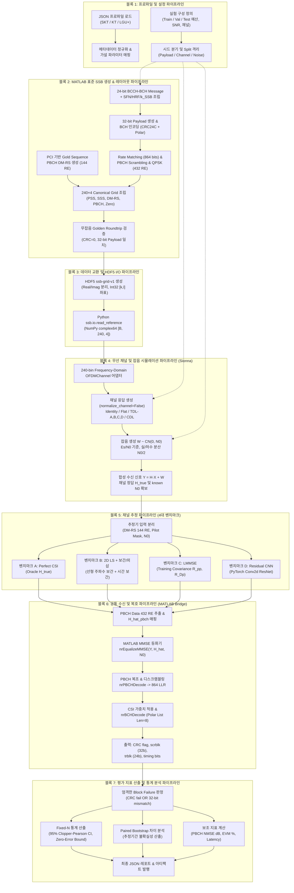
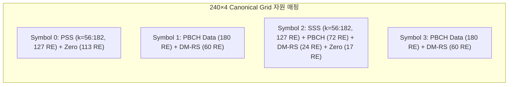
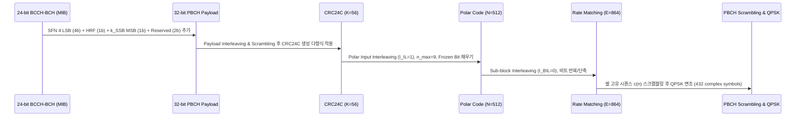
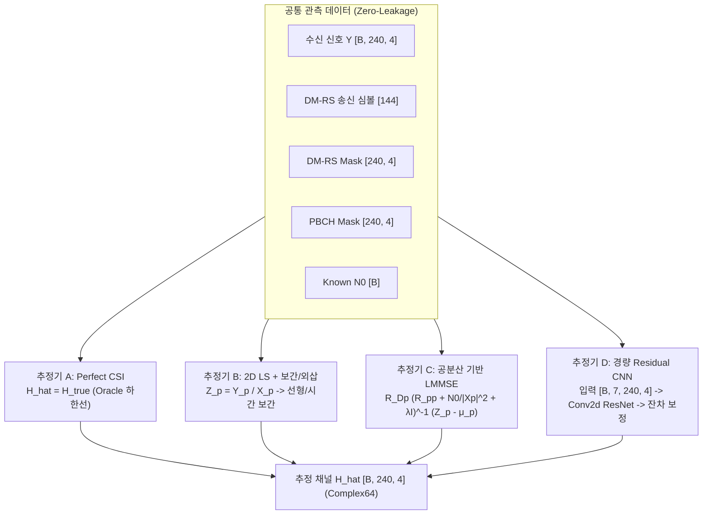
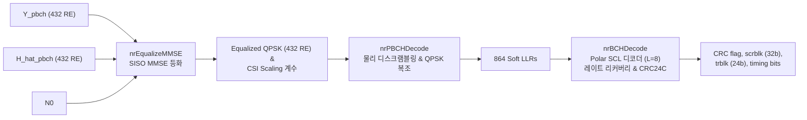

# 5G NR SS/PBCH 생성 및 PyTorch 채널 추정 파이프라인 아키텍처 및 상세 명세서

**문서 버전:** 1.0.0  
**작성일자:** 2026-11-12  
**관련 프로젝트 계획:** [PROJECT_PLAN.md](file:///C:/workspace/nr_ics/docs/PROJECT_PLAN.md)  
**구현 계약:** [IMPLEMENTATION_CONTRACT.md](file:///C:/workspace/nr_ics/docs/IMPLEMENTATION_CONTRACT.md)  
**상세 계획 문서:**
- MATLAB SS/PBCH 계획: [01_matlab_ssb.md](file:///C:/workspace/nr_ics/docs/planning/01_matlab_ssb.md)
- Python/Sionna 계획: [02_python_sionna.md](file:///C:/workspace/nr_ics/docs/planning/02_python_sionna.md)
- 추정기 및 평가 계획: [03_estimation_evaluation.md](file:///C:/workspace/nr_ics/docs/planning/03_estimation_evaluation.md)

---

## 1. 개요 및 파이프라인 전체 구조

### 1.1 프로젝트 목표 및 범위
본 시스템은 국내 이동통신 3사(SK Telecom, KT, LG U+)의 실제 관측 기지국 파라미터를 출발점으로 하여, **3GPP TS 38.211 / TS 38.212 Release 17 표준을 엄격히 준수하는 5G NR SS/PBCH 블록을 생성**하고, NVIDIA Sionna 무선 채널 모델을 거친 수신 신호 환경에서 **전통적 신호처리 기반 추정기(LS, LMMSE)와 딥러닝 기반 PyTorch 경량 Residual CNN 추정기의 성능을 공정하고 엄격하게 비교 평가(BLER-Es/N0 벤치마크)**하는 통합 신호처리 파이프라인입니다.

1차 주요 평가는 **동기화 정보(SSB boundary, PCI, SSB index)가 정확히 알려져 있고 CFO 및 타이밍 오차가 보정된 조건에서의 SISO 주파수 영역 PBCH BLER–$E_s/N_0$ 평가**입니다.

### 1.2 핵심 설계 3대 원칙
1. **표준 정합성 (Strict Standards Compliance):**
   - 3GPP TS 38.212 V17.5.0 §7.1 baseline(24-bit MIB, 32-bit BCH payload, CRC24C 부착 $K=56$, Polar code $N=512$, Rate matching $E=864$, QPSK 432 RE)을 엄격히 준수합니다.
   - PSS/SSS(각 127 RE), PBCH DM-RS(144 RE), PBCH Data(432 RE), Set-to-Zero(130 RE)로 구성된 표준 240×4 Canonical Grid를 엄격히 형성합니다.
2. **공정한 비교 및 무누출 원칙 (Fair Benchmarking & Zero-Leakage):**
   - 모든 채널 추정기(Perfect CSI, LS, LMMSE, Residual CNN)는 **동일한 수신 신호 $Y$, 동일한 DM-RS 관측값, 동일한 알려진 잡음 분산 $N_0$**를 입력받으며, **동일한 공통 MATLAB MMSE 등화기 및 PBCH/BCH 복호기(Polar list length=8)**를 거쳐 평가됩니다.
   - Ground truth 채널($H_{\mathrm{true}}$), 송신 비트 정답, 미관측 RE 데이터가 모델 학습 피처로 누출(leakage)되는 것을 원천 차단합니다.
   - 딥러닝 추정기가 전통 기법 대비 우수해야 한다는 편향을 배제하고, 성능 열화 역시 재현 가능한 유효한 결과로 인정합니다.
3. **엄격한 재현성 및 통계적 유의성 (Determinism & Fixed-N Statistics):**
   - 난수 시드 체계를 Master Seed로부터 Payload / Channel / Noise / Model 도메인별로 완전히 분리 파생(SHA-256 기반)하여 독립 Realization 간 중복을 방지합니다.
   - 최종 평가는 사전에 등록된 고정 표본수(Fixed-N) 및 고정 SNR 그리드에서 평가되며, 95% Clopper-Pearson 정확 이항 신뢰구간 및 0-error 상한선을 산출합니다.

---

### 1.3 엔드투엔드 파이프라인 흐름도 (End-to-End Block Pipeline)



---

## 2. 블록별 파이프라인 세부 명세

---

### 블록 1: 프로파일 및 설정 파이프라인 (Profile & Experiment Control Pipeline)

#### 1.1 입력 프로파일 명세 (통신사 3사 캡처 관측치)
시스템은 `NRdump/`에 위치한 JSON 및 DAT 파일 메타데이터를 출발점으로 사용합니다. 주파수 단위는 Hz로 정규화됩니다.

| 항목 | SK Telecom (`skt`) | KT (`kt`) | LG U+ (`lgu`) | 비고 / 표준 근거 |
| :--- | :--- | :--- | :--- | :--- |
| **PCI ($N_{\mathrm{ID}}^{\mathrm{cell}}$)** | 508 | 325 | 960 | $N_{\mathrm{ID}}^{\mathrm{cell}} = 3 N_{\mathrm{ID}}^{(1)} + N_{\mathrm{ID}}^{(2)}$ 일치 |
| **$N_{\mathrm{ID}}^{(1)} / N_{\mathrm{ID}}^{(2)}$** | 169 / 1 | 108 / 1 | 320 / 0 | PSS 시퀀스는 $N_{\mathrm{ID}}^{(2)}$로 결정 |
| **$v_{\mathrm{comb}} = \mathrm{PCI} \pmod 4$** | **0** | **1** | **0** | PBCH DM-RS 부반송파 주파수 오프셋 |
| **IQ Center 주파수** | 3,652,320,000 Hz | 3,547,500,000 Hz | 3,450,000,000 Hz | RF 튜닝 중심 주파수 |
| **SSREF 주파수** | 3,652,320,000 Hz | 3,550,080,000 Hz | 3,450,720,000 Hz | SSB 내부 부반송파 $k=120$의 주파수 |
| **GSCN / ARFCN** | 7952 / 643488 | 7881 / 636672 | 7812 / 미기재 | $\mathrm{SSREF} = 3000\mathrm{MHz} + (GSCN-7499)\times 1.44\mathrm{MHz}$ |
| **SSB Index 후보 ($i_{\mathrm{SSB}}$)** | 1 | 1 | 4 | Case C, $L_{\max}=8$ 기준 |
| **`ibar_ssb`** | 1 | 1 | 4 | $L_{\max}=8$에서 $\bar{i}_{\mathrm{SSB}} = i_{\mathrm{SSB}}$ |
| **공통 수치 스펙** | Case C, SCS 30 kHz, 240 subcarriers × 4 symbols, FFT 1024, Sampling Rate 30.72 MHz, 길이 40 ms |

#### 1.2 미확정 메타데이터 처리 정책
- **Point A 및 $k_{\mathrm{SSB}}$:** JSON에 기록된 `point_a_hz`와 `detected_ssb_sc_offset`은 51-PRB 로컬 창 관측값으로 해석되며 표준 Point A로 확정하지 않습니다. 합성 벤치마크에서는 완전한 상태가 제어되는 **합성 SFN, Half-Frame, $k_{\mathrm{SSB}}$**를 명시적으로 주입합니다.
- **RF 캡처 데이터 격리:** 원본 `.dat` 캡처 데이터는 수신 파이프라인의 **Sanity Check(무결성 검사)**에만 사용하며, 잡음 및 페이딩이 포함되어 있으므로 Clean Transmit Grid나 Channel Label($H_{\mathrm{true}}$)로 절대 사용하지 않습니다.

#### 1.3 실험 구성 및 데이터 분할 (Split Manifest)
실험 설정(`configs/experiments/*.json`)은 분할 표본 수와 채널/SNR 조건을 제어합니다:
- **Smoke Config (`smoke.json`):** 파이프라인 완전성 점검용 (Train 2, Val 2, Test 2, Identity/AWGN 5 dB).
- **Quick Config (`quick.json`):** 빠른 통합 검증용 (Train 16, Val 8, Test 4, Identity 및 TDL-C 5 dB, 3개 통신사).
- **Full Config (`full.json`):** 전체 신뢰구간 평가용 (Train 20,000, Val 4,000, Test 10,000, 다중 SNR 및 일반화 조건).

#### 1.4 난수 시드(Seed) 도메인 격리 및 Audit
Data Leakage를 원천 차단하기 위해 Master Seed(예: `20261112`)로부터 SHA-256 해시를 통해 독립적인 정수 시드를 유도합니다:
$$\mathrm{Seed}_{\mathrm{domain}} = \mathrm{SHA256}(\text{"[master, profile, split, domain]"})[:4]$$
- **Payload Seed:** MIB 메시지 및 SFN/HRF 비트 생성 통제
- **Channel Seed:** 페이딩 채널 실현(Fading Realization) 생성 통제
- **Noise Seed:** 백색 가우시안 잡음 실현 생성 통제
- **Model Seed:** PyTorch 신경망 가중치 초기화 통제
- `audit_splits()` 함수는 각 파티션 간 Trajectory ID 중복이 0이고, 모든 난수 시드가 상호 고유함을 기계적으로 검증합니다.

---

### 블록 2: 표준 SS/PBCH 생성 및 레이아웃 파이프라인 (MATLAB Reference Producer)



#### 2.1 자원 격자 (Canonical Resource Grid) 상세 규약
SS/PBCH 블록은 주파수 축 240개 부반송파($k=0\dots 239$), 시간 축 4개 OFDM 심볼($l=0\dots 3$)로 정의되는 **총 960 RE** 크기입니다.

| 신호 (Signal) | 심볼 인덱스 ($l$) | 부반송파 인덱스 ($k$) | RE 수 | Class ID |
| :--- | :--- | :--- | :--- | :--- |
| **PSS** | $l=0$ | $k=56\dots 182$ | 127 | 1 |
| **SSS** | $l=2$ | $k=56\dots 182$ | 127 | 2 |
| **PBCH DM-RS** | $l=1, 3$ <br> $l=2$ | $k = v_{\mathrm{comb}} + 4m,\; m=0\dots 59$ <br> $k = v_{\mathrm{comb}} + 4m,\; m \in \{0\dots 11\} \cup \{48\dots 59\}$ | 60 + 60 = 120 <br> 24 | 3 (총 144 RE) |
| **PBCH Data** | $l=1, 3$ <br> $l=2$ | $k=0\dots 239$ 중 DM-RS 제외 <br> $k \in \{0\dots 47\} \cup \{192\dots 239\}$ 중 DM-RS 제외 | 180 + 180 = 360 <br> 72 | 4 (총 432 RE) |
| **Set-to-Zero** | $l=0$ <br> $l=2$ | $k \in \{0\dots 55\} \cup \{183\dots 239\}$ <br> $k \in \{48\dots 55\} \cup \{183\dots 191\}$ | 113 <br> 17 | 0 (총 130 RE) |
| **합계** | **4 Symbols** | **240 Subcarriers** | **960 RE** (Active 830, Zero 130) | - |

- **좌표 순서 규약:** 0-based signed int32 `[k, l]` 좌표계 사용. 심볼 인덱스 $l$ 오름차순, 동일 심볼 내에서는 부반송파 인덱스 $k$ 오름차순으로 엄격히 정렬합니다.

#### 2.2 TS 38.212 V17.5.0 기준 BCH 인코딩 체인
합성 송신 블록은 임의의 무작위 비트열이 아닌, 표준 규격을 완벽히 통과하는 합법적인 BCH 부호어로 생성됩니다.



1. **BCCH-BCH-Message (24 bits):** 6비트 SFN MSB, subcarrierSpacingCommon, ssb-SubcarrierOffset 4 LSB, dmrs-TypeA-Position, pdcch-ConfigSIB1, cellBarred, intraFreqReselection 및 spare 1비트 포함.
2. **PBCH Payload (32 bits):** 24비트 MIB에 타이밍 필드 8비트 부가.
   - SFN 4 LSB (비트 24~27)
   - Half-Frame bit $n_{\mathrm{hf}}$ (비트 28)
   - $k_{\mathrm{SSB}}$ MSB (비트 29, FR1 $L_{\max}=8$ 기준)
   - Reserved bits (비트 30~31, 0으로 고정)
3. **Payload Interleaving & Scrambling:** 32비트 페이로드 인터리빙 후 셀 ID 기반 스크램블링.
4. **CRC24C 부착 ($K=56$):** 생성 다항식 $g_{\mathrm{CRC24C}}(D)$ 적용, 24비트 패리티 부착.
5. **Polar Encoding ($N=512$):** 입력 인터리빙 $I_{\mathrm{IL}}=1$, 모부호 길이 $N=2^9=512$.
6. **Rate Matching ($E=864$):** coded bit 인터리빙 $I_{\mathrm{BIL}}=0$, 원형 버퍼 기반 레이트 매칭.
7. **PBCH Scrambling & QPSK Mapping:** $v_{\mathrm{pbch}} = i_{\mathrm{SSB}} \pmod 8$ 위상 기반 스크램블링 후 QPSK 변조하여 **432개 복소 심볼** 생성.

#### 2.3 PBCH DM-RS 시퀀스 생성
- 의사 난수 골드 시퀀스(Gold Sequence) $c(n)$ 초기화 ($c_{\mathrm{init}}$):
  $$c_{\mathrm{init}} = 2^{11}(\bar{i}_{\mathrm{SSB}} + 1)(\lfloor N_{\mathrm{ID}}^{\mathrm{cell}} / 4 \rfloor + 1) + 2^6(\bar{i}_{\mathrm{SSB}} + 1) + (N_{\mathrm{ID}}^{\mathrm{cell}} \bmod 4)$$
  - $L_{\max}=8$ baseline에서 $\bar{i}_{\mathrm{SSB}} = i_{\mathrm{SSB}}$ 이며, half-frame은 DM-RS 초기화에 영향을 주지 않습니다.
- 변조: QPSK 변조 심볼 $r(m) = \frac{1}{\sqrt{2}}(1 - 2c(2m)) + j\frac{1}{\sqrt{2}}(1 - 2c(2m+1))$, $m=0\dots 143$ (144개 심볼).

#### 2.4 Golden Roundtrip 검증 기준
잡음과 채널이 없는 무잡음 조건(`H=1`, `noise=0`)에서 MATLAB `nrBCH` $\rightarrow$ `nrPBCH` $\rightarrow$ `nrPBCHDecode` $\rightarrow$ `nrBCHDecode` 체인을 거쳤을 때:
- $\mathrm{CRC} = 0$ (오류 플래그 없음)
- 디코더의 첫 출력인 Scrambled 32-bit 블록이 송신 정답과 100% 비트 일치
- 복원된 24-bit MIB 및 SFN, Half-frame, $k_{\mathrm{SSB}}$가 송신 입력과 100% 일치해야 함.

---

### 블록 3: 이종 시스템 데이터 교환 파이프라인 (HDF5 Schema & MATLAB Bridge)

MATLAB(신호 생성/복호)과 Python/PyTorch(채널 시뮬레이션/신경망 추정) 간의 무손실 데이터 연동을 위한 규약입니다.

#### 3.1 HDF5 `ssb-grid-v1` 스키마 명세
모든 다차원 배열은 Python `h5py`로 읽었을 때의 기준 축과 형상을 가집니다. 복소수는 `_real`과 `_imag` float32 배열로 분리 저장합니다.

```
/ (root)
├── [attr] schema_version = "ssb-grid-v1"
├── [attr] axis_order = ["batch", "subcarrier", "symbol"]
├── [attr] index_columns = ["k", "l"]
├── [attr] index_base = 0
│
├── tx/
│   ├── grid_real: float32 [B, 240, 4]      # 송신 SSB 표준 그리드 (실수부)
│   ├── grid_imag: float32 [B, 240, 4]      # 송신 SSB 표준 그리드 (허수부)
│   ├── dmrs_real: float32 [144]            # 정렬된 DM-RS 송신 심볼 (실수부)
│   └── dmrs_imag: float32 [144]            # 정렬된 DM-RS 송신 심볼 (허수부)
│
├── re/
│   ├── dmrs_kl: int32 [144, 2]             # DM-RS 좌표 [k, l] (0-based)
│   ├── pbch_kl: int32 [432, 2]             # PBCH Data 좌표 [k, l] (0-based)
│   ├── pss_kl: int32 [127, 2]              # PSS 좌표 [k, l] (0-based)
│   ├── sss_kl: int32 [127, 2]              # SSS 좌표 [k, l] (0-based)
│   ├── class_id: uint8 [240, 4]            # RE 분류 맵 (0:Zero, 1:PSS, 2:SSS, 3:DM-RS, 4:PBCH)
│   ├── mask_dmrs: uint8 [240, 4]           # DM-RS 불리언 마스크
│   ├── mask_pbch: uint8 [240, 4]           # PBCH 불리언 마스크
│   └── mask_active: uint8 [240, 4]         # Active RE 마스크 (총 830개)
│
├── bits/
│   ├── bch_transport: uint8 [B, 24]        # 24비트 MIB 전송 블록 정답
│   ├── bch_payload_scrambled32: uint8 [B, 32] # 32비트 스크램블된 페이로드 정답 (Primary BLER 타겟)
│   ├── bch_rate_matched: uint8 [B, 864]    # 레이트 매칭 후 864 비트
│   ├── sfn: uint16 [B]                     # 10비트 SFN (0~1023)
│   ├── half_frame: uint8 [B]               # Half-frame (0 또는 1)
│   └── k_ssb: uint8 [B]                    # k_SSB 값 (0~31)
│
└── meta/
    └── manifest_json: UTF-8 String         # 생성 파라미터, 도메인 시드, SHA-256
```

#### 3.2 축 변환 및 Flattening 주의 규칙
- MATLAB은 Column-Major(Fortran 순서)이며, Python NumPy/PyTorch는 Row-Major(C 순서)입니다.
- Batch 축이 포함된 다차원 배열에 `reshape(order="F")`를 일괄 적용하면 Batch 축과 Spatial 축이 꼬이므로 엄격히 금지합니다.
- 변환은 반드시 **명시적 Transpose와 0-based `[k, l]` Gather/Scatter 연산**으로만 수행합니다.

#### 3.3 MATLAB Bridge Decoder I/O 계약
- **실행 모드:** Python `subprocess` 기반 비동기/동기 프로세스 호출. 불필요한 GUI 윈도우 생성을 차단(`-batch` 또는 `-nodesktop -nosplash -r`).
- **입력 파일 (`ssb-decode-v1`):**
  - `/rx/grid_real`, `/rx/grid_imag`: float32 `[B, 240, 4]` (추정기별 블록들을 Batch 축으로 결합)
  - `/estimate/grid_real`, `/estimate/grid_imag`: float32 `[B, 240, 4]` (각 추정기의 $\hat{H}$)
  - `/noise/no`: float32 `[B]` (알려진 잡음 분산 $N_0$)
  - `/meta/manifest_json`: PCI, SSB Index, Lmax, List Length 정보
- **출력 파일 (`ssb-decode-result-v1`):**
  - `/decoded/crc`: uint8 `[B]` (0: CRC 통과, 1: CRC 실패)
  - `/decoded/scrblk`: uint8 `[B, 32]` (복원된 32비트 Scrambled 페이로드)
  - `/decoded/trblk`: uint8 `[B, 24]` (복원된 24비트 MIB 전송 블록)
  - `/decoded/sfn_lsb`: uint8 `[B, 4]` (복원된 SFN 하위 4비트)
  - `/decoded/half_frame`: uint8 `[B]` (복원된 Half-frame 비트)
  - `/decoded/msb_index_offset`: uint8 `[B]` (복원된 $k_{\mathrm{SSB}}$ MSB / Index Offset)
  - `/decoded/error_code`: uint8 `[B]` (0: 정상, 1: 입력 NaN/Inf, 2: LLR 수치 이상)

---

### 블록 4: 무선 채널 및 잡음 시뮬레이션 파이프라인 (Sionna / PyTorch)

#### 4.1 Reduced Frequency-Domain OFDM 모델
캡처 전체 대역의 1024 FFT가 아닌, 표준 SS/PBCH가 점유하는 **240-bin 기저대역 주파수 영역 모델**로 정식화합니다.
- `ResourceGrid`: `num_ofdm_symbols=4`, `fft_size=240`, `subcarrier_spacing=30000`, `num_tx=1`, `num_rx=1`, `dc_null=False`.
- **DC Null 금지 (`dc_null=False`):** 짝수 FFT 240의 중앙($k=120$)은 SSREF 주파수 위치이며 실제 유효한 신호가 전송되므로, DC Nulling을 켜면 신호가 영문화(Zero-out)되어 정보가 손실됩니다.

#### 4.2 지원 채널 패밀리
`ssb.channels.apply_channel(x, config, snr_db, seed)`는 PyTorch 텐서를 입력받아 시뮬레이션을 수행합니다.
1. `identity`: 이상적인 채널 ($H = 1$), 알고리즘 파이프라인 무결성 검증용.
2. `flat`: 레일리/라이시안 평탄 페이딩 (Complex Gaussian).
3. `tdl`: 3GPP TR 38.901 TDL 채널 모델 (Sionna 2.2.0 정식 API).
   - Profiles: `TDL-A` (NLOS), `TDL-B` (NLOS), `TDL-C` (NLOS), `TDL-D` (LOS).
   - RMS Delay Spread: 30 ns, 100 ns (기본), 300 ns (일반화 확장).
   - Maximum Doppler: Speed 0 m/s (기본 정적), 3 m/s, 30 m/s (이동성 확장).
4. `cdl`: 3GPP TR 38.901 CDL 채널 모델 (단일 V-편파 안테나, 광학적 각도 설정).

#### 4.3 채널 전력 정규화 및 잡음 주입 규약
- **`normalize_channel=False`:** 개별 블록마다 임의로 채널 전력을 정규화하면 페이딩의 깊이(Deep Fade)가 인위적으로 사라지므로 금지합니다. 독립 Realization 앙상블 전체에 대해 $\mathbb{E}[|H|^2] = 1$을 보장하며, 필요 시 Training Set에서 산출한 고정 스칼라 `ensemble_scale`만 적용합니다.
- **$E_s/N_0$ 정의:** 송신 PBCH Data RE당 평균 심볼 에너지 $E_s = 1$ (단위 에너지 QPSK).
  $$N_0 = E_s \cdot 10^{-\mathrm{SNR}_{\mathrm{dB}} / 10}$$
- **복소 잡음 생성:**
  $$W \sim \mathcal{CN}(0, N_0) \implies W = \sqrt{\frac{N_0}{2}}(W_{\mathrm{real}} + j W_{\mathrm{imag}}),\quad W_{\mathrm{real}}, W_{\mathrm{imag}} \sim \mathcal{N}(0, 1)$$
- **수신 신호 형성:** $Y[k, l] = H[k, l] \cdot X[k, l] + W[k, l]$
- **잡음 정보 제공 규약:** 주 비교에서는 잡음 생성에 사용된 정확한 $N_0$를 모든 추정기, 등화기, 복호기에 공통 제공하며 메타데이터에 `noise_source="known_simulation"`으로 명시합니다. (추정기 성능만을 순수하게 비교하기 위한 통제 조건이며 비정상 정보 누출이 아님)

---

### 블록 5: 채널 추정 파이프라인 (Channel Estimation Pipeline - 4대 벤치마크)



#### 5.1 추정기 A: Perfect CSI (Oracle Upper Bound)
- 실제 시뮬레이터가 적용한 참 채널 $H_{\mathrm{true}}$를 그대로 반환합니다.
- 추정 오차가 0일 때 달성 가능한 BLER의 이론적 최적 성능(Lower Bound)을 제시합니다.

#### 5.2 추정기 B: 2D LS + 선형/외삽 보간기 (Classical Baseline)
1. **Pilot LS 추정:** DM-RS 144개 위치에서 $Z_p = Y_p / X_p$.
2. **심볼 1 및 3 주파수 보간:** 각 심볼 내 60개 DM-RS 파일럿($\Delta k = 4$) 사이를 실수부와 허수부 독립적으로 1D 선형 보간. 양 끝단(첫 파일럿 이전, 마지막 파일럿 이후)은 가장 가까운 파일럿 값을 유지하는 상수 외삽(Constant Extrapolation) 적용.
3. **심볼 2 주파수 보간:** PBCH 영역인 $k \in [0, 47]$ (파일럿 12개) 및 $k \in [192, 239]$ (파일럿 12개)의 두 분리된 구간 내부에서만 각각 선형 보간 및 외삽 수행.
4. **심볼 2 중앙 결손 영역 및 전 심볼 확장:** 심볼 2의 중앙 공백($k \in [48, 191]$)은 심볼 1과 심볼 3의 보간 결과를 시간 축으로 선형 평균하여 채움. 심볼 0(PSS 영역)은 심볼 1의 추정값을 복제.

#### 5.3 추정기 C: 공분산 기반 LMMSE 추정기 (Optimal Linear Estimator)
- **수학적 정식화:**
  $$\hat{h}_D = \mu_D + R_{Dp} \left( R_{pp} + \mathrm{diag}(N_0 / |X_p|^2) + \lambda I \right)^{-1} (z_p - \mu_p)$$
  - $z_p \in \mathbb{C}^{144}$: DM-RS RE에서의 LS 추정 벡터 ($Y_p / X_p$)
  - $\hat{h}_D \in \mathbb{C}^{432}$: PBCH Data 432개 RE에서의 추정 채널 벡터
  - $R_{pp} \in \mathbb{C}^{144 \times 144}$: 파일럿 RE 간 채널 공분산 행렬
  - $R_{Dp} \in \mathbb{C}^{432 \times 144}$: 데이터 RE와 파일럿 RE 간 상호 공분산 행렬
  - $\lambda$: 수치적 안정성을 위한 Diagonal Loading 계수 (기본값 $10^{-4}$ 또는 $10^{-3}$)
- **공정성 보장:** $R_{pp}$와 $R_{Dp}$는 **Training Set 채널 실현에서만 사전에 계산**되며, Test Set의 채널 정보나 실시간 Realization별 통계로 재적합(refit)하지 않습니다.

#### 5.4 추정기 D: PyTorch 경량 Residual CNN 추정기
- **입력 피처 구성 ($C=7$ 채널, Shape `[B, 7, 240, 4]`):**
  1. `Re(H_init)`: LS 2D 보간 채널 실수부
  2. `Im(H_init)`: LS 2D 보간 채널 허수부
  3. `Re(Z_p)`: DM-RS RE 위치에만 배치된 LS 파일럿 실수부 (나머지 0)
  4. `Im(Z_p)`: DM-RS RE 위치에만 배치된 LS 파일럿 허수부 (나머지 0)
  5. `M_dmrs`: DM-RS 마스크 (0 또는 1)
  6. `M_pbch`: PBCH Data 마스크 (0 또는 1)
  7. `log(N0)`: 공간적으로 브로드캐스팅된 잡음 분산 맵
- **신경망 아키텍처:**
  - **Stem:** `Conv2d(7, width, kernel_size=3, padding=1)` + `GELU` (기본 width=32, 파라미터 약 5~6만 개 이하)
  - **Residual Body:** 3개의 `ResidualBlock` (각 블록: `Conv2d` $\rightarrow$ `GELU` $\rightarrow$ `Conv2d` + Identity Shortcut). *배치 통계 누출 및 SNR 분포 유추를 방지하기 위해 BatchNorm은 엄격히 배제.*
  - **Head:** `Conv2d(width, 2, kernel_size=3, padding=1)` $\rightarrow$ 복소 잔차 $\Delta H_{\mathrm{real}}, \Delta H_{\mathrm{imag}}$ 출력
  - **최종 출력:** $\hat{H} = H_{\mathrm{init}} + (\Delta H_{\mathrm{real}} + j \Delta H_{\mathrm{imag}})$
- **손실 함수 (Loss Function):** PBCH Data RE 영역에서만 계산되는 Complex MSE:
  $$\mathcal{L}_{\mathrm{MSE}} = \frac{1}{|\mathcal{D}|} \sum_{(k, l) \in \mathcal{D}} |\hat{H}[k, l] - H_{\mathrm{true}}[k, l]|^2$$
- **체크포인트 선택:** 독립적인 Validation Set의 Masked MSE가 최소인 모델 가중치를 채택.

---

### 블록 6: 공통 수신 및 복호 파이프라인 (Common Receiver & PBCH/BCH Decoding)

추정기 간의 공정한 비교를 위해 모든 방법($\hat{H}$)은 동일한 수신기 체인을 통과합니다.



1. **자원 추출 (Extraction):** 240×4 수신 신호 $Y$ 및 추정 채널 $\hat{H}$에서 정렬된 432개 PBCH Data RE를 추출.
2. **SISO MMSE 등화 (`nrEqualizeMMSE`):**
   $$\hat{X}_{\mathrm{pbch}}[m] = \frac{\hat{H}^*[m]}{|\hat{H}[m]|^2 + N_0} Y_{\mathrm{pbch}}[m],\quad \mathrm{CSI}[m] = |\hat{H}[m]|^2 + N_0$$
3. **PBCH 복조 및 디스크램블링 (`nrPBCHDecode`):**
   - 셀 ID 및 $v_{\mathrm{pbch}} = i_{\mathrm{SSB}} \pmod 8$ 위상 기반 의사 난수 시퀀스로 디스크램블링 수행.
   - QPSK 소프트 복조를 통해 **864개 LLR(Log-Likelihood Ratio)** 생성 (음수가 비트 1에 대응).
4. **CSI 가중치 적용:** 각 RE의 CSI 값을 해당 RE의 두 LLR 위치에 곱하여 신뢰도 스케일링 수행.
5. **Polar 리스트 복호기 (`nrBCHDecode`):**
   - **List Length = 8**로 고정.
   - Polar 디코딩, 레이트 복원(Rate Recovery), 입력 디인터리빙, CRC24C 오류 검출 수행.
   - **출력:**
     - `scrblk`: Scrambled 32-bit 페이로드 (BCH 디스크램블링 이전 단계)
     - `errFlag`: CRC 오류 플래그 (0: 무오류 통과, 1: 오류 발생)
     - `trblk`: 복원된 24-bit MIB 전송 블록
     - `lsbofsfn`: 복원된 SFN 하위 4비트
     - `hrf`: 복원된 Half-Frame 비트
     - `msbidxoffset`: 복원된 $k_{\mathrm{SSB}}$ 상위 비트

---

### 블록 7: 지표 산출, 검증 및 통계 분석 파이프라인 (Metrics & Statistical Evaluation)

#### 7.1 엄격한 블록 실패(Block Failure) 판정
단순히 CRC 플래그만 검사할 경우 Polar 부호의 잔여 미검출 오류(Undetected Error)가 누락될 수 있으므로, 합성 벤치마크에서는 **송신 정답 32-bit Scrambled 페이로드와 100% 완전 일치**를 요구합니다.

$$\text{Block Failure} \iff (\mathrm{CRC} \neq 0) \;\lor\; (\hat{b}_{\mathrm{scr32}} \neq b_{\mathrm{scr32}}) \;\lor\; (\mathrm{ErrorCode} \neq 0)$$

- **세부 진단 카운터 집계:**
  - $N_{\mathrm{crc\_fail}}$: CRC 체크 실패 블록 수
  - $N_{\mathrm{payload\_mismatch}}$: 32비트 페이로드 불일치 블록 수
  - $N_{\mathrm{undetected}}$: **CRC는 통과했으나 페이로드가 불일치한 미검출 오류 수**
  - $N_{\mathrm{mib\_match}}$: 24비트 MIB 전송 블록 일치 수
  - $N_{\mathrm{timing\_match}}$: SFN LSB 및 Half-frame 일치 수

#### 7.2 고정 표본수(Fixed-N) 통계 및 신뢰구간
- 총 시험 횟수 $N$, 오류 블록 수 $e$에 대해 추정 블록 오류율은 $\widehat{\mathrm{BLER}} = e / N$ 입니다.
- **양측 95% Clopper-Pearson 정확 이항 신뢰구간 (Exact Binomial CI):**
  $$[\mathrm{Beta}^{-1}(0.025;\, e,\, N - e + 1),\; \mathrm{Beta}^{-1}(0.975;\, e + 1,\, N - e)]$$
- **무오류 ($e = 0$) 발생 시 단측 95% 상한선 (Zero-Error Upper Bound):**
  $$p_{\mathrm{upper}} = 1 - (0.05)^{1/N} \approx \frac{3}{N}$$
  *(예: $N=10,000$에서 오류가 0개인 경우, BLER가 0이 아니라 95% 신뢰수준에서 $3.0 \times 10^{-4}$ 이하임을 보고)*

#### 7.3 Paired Bootstrap 차이 분석
동일한 채널 및 잡음 실현 샘플에서 두 추정기(예: CNN과 LS)가 평가되므로, 추정기간 성능 차이의 유의성을 독립 이항 분포가 아닌 **Paired Sample 단위 Bootstrap(1,000회 재표본화)**으로 분석하여 평균 차이와 95% 신뢰구간을 도출합니다.

#### 7.4 보조 물리 지표
1. **PBCH 채널 NMSE (Normalized Mean Squared Error):**
   $$\mathrm{NMSE}_{\mathrm{dB}} = 10 \log_{10} \left( \frac{\sum_{(k, l) \in \mathcal{D}} |\hat{H}[k, l] - H_{\mathrm{true}}[k, l]|^2}{\sum_{(k, l) \in \mathcal{D}} |H_{\mathrm{true}}[k, l]|^2} \right)$$
2. **MMSE 등화 심볼 PBCH EVM (Error Vector Magnitude):**
   $$\mathrm{EVM}_{\%} = \sqrt{ \frac{\sum_{m=1}^{432} |\hat{X}_{\mathrm{pbch}}[m] - X_{\mathrm{pbch}}[m]|^2}{\sum_{m=1}^{432} |X_{\mathrm{pbch}}[m]|^2} } \times 100$$
3. **실행 시간 프로파일링:** 추정기 추론 시간(Estimator Wall Time, GPU 동기화 포함) 및 MATLAB 복호기 배치 처리 시간 분리 측정.

---

## 3. 마일스톤 단계 및 검증 수용 기준 (Milestone Gates Summary)

본 시스템은 체계적인 수용 기준(Acceptance Gate)에 따라 단계별로 검증이 완료되었거나 확장 평가를 준비하고 있습니다.

| 단계 | 명칭 | 주요 구현체 및 산출물 | 핵심 수용 검사 기준 (Pass Criteria) | 현재 상태 |
| :---: | :--- | :--- | :--- | :---: |
| **M0** | **기준 규약 및 표준 참조** | `matlab/+ssb/layout.m`, `encode.m`, `export_reference.m`, TS 38.212 V17.5.0 규격 | 세 통신사 및 comb 0~3 좌표/마스크 일치 (127/127/144/432/130 RE). 무잡음 BCH roundtrip에서 CRC=0 및 32비트 페이로드 100% 일치. | **검증 완료** (4 MATLAB tests pass) |
| **M1** | **이종 연동 및 채널/잡음 브릿지** | `python/ssb/io.py`, `channels.py`, `matlab_bridge.py`, HDF5 `ssb-grid-v1` | HDF5 왕복 무손실 일치. 잡음 분산 분할 $\pm 2\%$ 이내 검증. $H=1$ 무잡음 조건에서 Python-MATLAB 브릿지 복호 CRC=0, 32-bit payload 일치. | **검증 완료** (35 Python tests pass) |
| **M2** | **전통 추정기 베이스라인** | `python/ssb/estimators.py` (LS, LMMSE), `covariance.pt` | 심볼 1/2/3 LS 보간 규칙 고정. Training 채널 기반 LMMSE 공분산 계산 및 Diagonal Loading 안정성 확보. | **검증 완료** |
| **M3** | **경량 CNN 추정기 개발** | `python/ssb/models.py`, `training.py` (Residual CNN) | BatchNorm 미사용, Zero-Leakage 피처 준수. 독립 Validation 기반 체크포인트 선택 및 GPU 역전파/손실 감소 검증. | **검증 완료** |
| **M4** | **통합 벤치마크 및 통계 평가** | `python/ssb/benchmark.py`, `ssb-benchmark` CLI | Paired 추정기 평가, Fixed-N 95% Clopper-Pearson 신뢰구간 산출, 32-bit strict failure 및 NMSE/EVM 집계. Smoke/Quick 실행 통과. | **검증 완료** (Quick 통과, Full 실행 가능) |
| **M5** | **선택 확장 트랙** | 파일럿 기반 $N_0$ 추정, Python 독자 Polar 디코더, Time-domain 수신 | 추정 $N_0$ robustness 평가, MATLAB 대비 bit-level 일치 독립 Python 디코더, 물리 파형 프레임 동기화. | 후속 확장 |

---

## 4. 파일 맵 및 모듈 책임 구조

```
C:\workspace\nr_ics\
├── configs/experiments/
│   ├── smoke.json               # 파이프라인 smoke test 설정
│   ├── quick.json               # 빠른 3사 통합 검증 설정
│   └── full.json                # 20k/4k/10k 전체 대규모 벤치마크 설정
├── matlab/+ssb/
│   ├── layout.m                 # 240x4 Canonical 그리드 및 0-based 좌표 생성
│   ├── encode.m                 # TS 38.212 V17.5.0 BCH 부호화 및 SSB 변조
│   ├── extract_pilots.m         # DM-RS 파일럿 추출 및 LS 계산
│   ├── export_reference.m       # 합성 Golden Reference HDF5 파일 생성
│   ├── decode_pbch.m            # 단일 블록 MMSE 등화 및 nrBCHDecode 복호
│   ├── decode_batch_file.m      # 배치 HDF5 입력 복호 및 결과 파일 출력
│   ├── load_profile.m           # 통신사 JSON 프로파일 로드
│   └── recover_capture.m        # 실제 .dat 캡처 신호 동기화 및 복호 무결성 검사
├── python/ssb/
│   ├── profiles.py              # 통신사 canonical 프로파일 로더
│   ├── layout.py                # Python 측 표준 레이아웃 및 Sionna PilotPattern
│   ├── io.py                    # HDF5 ssb-grid-v1 읽기/쓰기 및 검증
│   ├── channels.py              # Sionna 2.2.0 OFDMChannel / TDL / CDL 어댑터
│   ├── matlab_bridge.py         # Subprocess 기반 MATLAB Reference/Decoder 브릿지
│   ├── estimators.py            # Perfect CSI, LS 2D 보간기, LMMSE 추정기
│   ├── models.py                # PyTorch 경량 Residual CNN 신경망 모델
│   ├── training.py              # Masked MSE 손실함수 및 Early-Stopping 학습 루프
│   ├── metrics.py               # 32-bit Strict Failure, Exact Binomial CI, NMSE, EVM
│   ├── benchmark.py             # Fixed-N Paired 벤치마크 오케스트레이터
│   └── cli.py / __main__.py     # ssb-benchmark 커맨드라인 인터페이스
├── tests/
│   ├── matlab/test_ssb.m        # MATLAB 단위 테스트 (레이아웃, 부호화, 복호)
│   └── python/test_*.py         # Python 단위 테스트 (프로파일, 채널, 추정기, 브릿지 등)
└── docs/
    ├── PROJECT_PLAN.md          # 최상위 프로젝트 통합 계획
    ├── IMPLEMENTATION_CONTRACT.md# 모듈 간 API 및 파일 소유권 계약
    └── BLOCK_PIPELINE_ARCHITECTURE.md # (본 문서) 파이프라인 블록 구조 및 상세 명세
```

---

## 5. 결론 및 향후 운용 가이드

본 시스템은 MATLAB의 표준 규격 정합성과 Python/Sionna/PyTorch의 유연한 딥러닝 채널 추정 능력을 완벽하게 결합한 아키텍처를 갖추고 있습니다.

1. **테스트 재현 및 무결성 확인:**
   ```powershell
   # Python 전체 단위 테스트 실행 (현재 47개 테스트 전원 통과)
   .\.venv\Scripts\python.exe -m pytest tests/python -q

   # Quick 벤치마크 실행 (통신사 3사, TDL-C, 4대 추정기 Paired 실행)
   .\.venv\Scripts\ssb-benchmark.exe run --config configs/experiments/quick.json
   ```
2. **대규모 Full 실험 실행:**
   - `configs/experiments/full.json`의 `test_count`와 `training_seeds`를 컴퓨팅 예산(GPU 시간 및 MATLAB 복호 시간)에 맞춰 조정한 후 `ssb-benchmark run --config configs/experiments/full.json`을 실행하여 최종 논문/보고서 수준의 BLER 곡선과 95% 신뢰구간을 추출할 수 있습니다.
